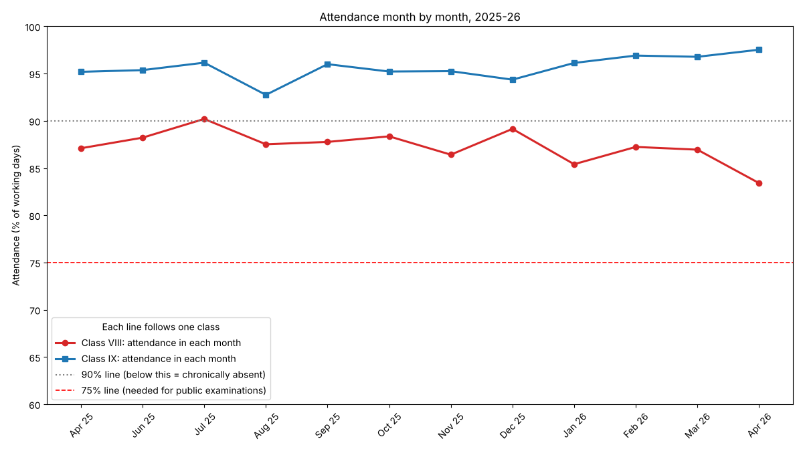
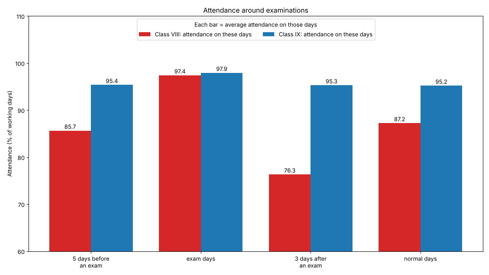
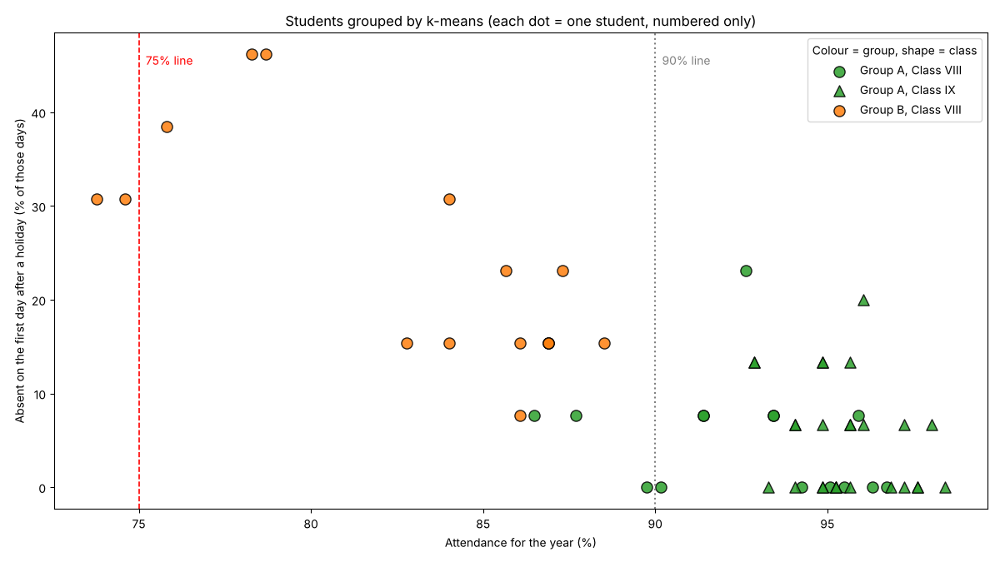
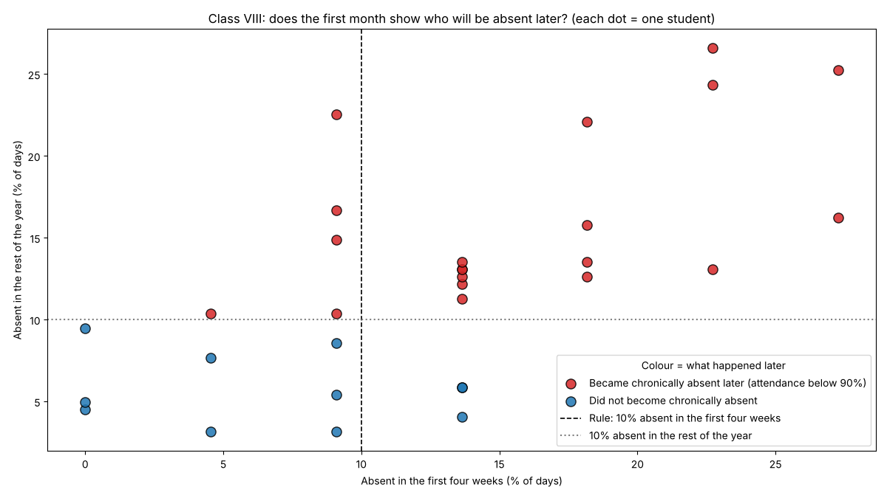

# School attendance study: data analysis and machine learning
 
How does attendance differ between two classes (Class VIII and Class IX),
what changes it, and can the first month of the year show who will be
chronically absent later?
 
## Data
attendance_register.csv is the school's daily attendance register, April 2025
to April 2026, one row per student per day. Students are numbers coded by the
school. There are no names or other personal details. The data were shared by
the school with permission.
Columns: cls (class), student (number), date, status (P present, A absent,
H holiday), rain_mm (rainfall that day), listed_holiday (True on listed holidays).
 
## Result
- Attendance: Class IX 95.52%, Class VIII 87.63% (difference 7.89 points,
  p < 0.001). 19 of 31 Class VIII students were below 90%.
- Weekday and rain: no clear difference.
- After exams, Class VIII fell to 76.34%, mostly after the December and
  final exams, which sit next to long holidays.
- k-means: a group of 15 Class VIII students with 82.6% attendance.
- Early warning: absent 10% or more in the first 4 weeks was right for
  74.2% of Class VIII students (baseline 64.5%, 95% range 56.8% to 86.3%).
 

 
## How to run (Google Colab, no installation)
1. Open colab.research.google.com and start a new notebook.
2. Click the folder icon on the left, then the upload icon, and upload
   attendance_register.csv.
3. Paste attendance_core.py into a cell and run it. It should end with:
   All checks passed.
4. Paste step2_analysis.py, then step3_ml.py, into new cells in the same
   notebook and run them. The charts and tables appear below the cells.
 
## Files
- attendance_core.py: reads the register, adds the columns, tests
- attendance_register.csv: the data (students are numbers only)
- step2_analysis.py: tables and charts (months, weekday, rain, exams)
- step3_ml.py: k-means groups and the early-warning rule
- writeup.pdf: full write-up
 
## Method in short
- Attendance % = days present / working days x 100. Chronic absence = below 90%.
- Differences between classes: permutation test. Differences inside a class:
  paired by student, with a bootstrap 95% range.
- k-means on four standardised measures; number of groups by silhouette score.
- Early warning: first 22 working days; compared with leave-one-out logistic
  regression and a baseline.
- Rainy day = 2.5 mm or more (IMD definition).

## Limits
One school, one year, two classes. The register shows only present or absent, not the reason. Patterns here are associations, not causes.

## Privacy
The data came from a school, with permission. Students are numbers coded by
the school, with no names. Please do not try to identify any student.
 
## Author and acknowledgements
kessiamk. Guidance from Mrs. Saranya (CS teacher). AI tools (Claude)
helped write and check the code and drafted the first version of the write-up.
I ran the code and rewrote the text myself.
 
## Licence
MIT Licence. See the LICENSE file.

